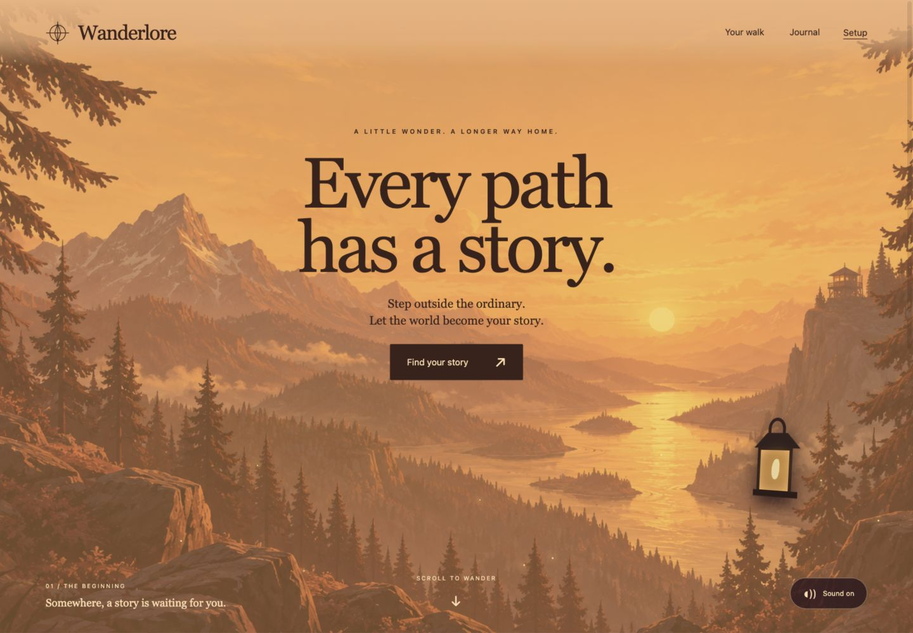

# Wanderlore

A narrated, interactive story that follows your walk. Choose folklore, mystery, or fantasy; pick a duration and weather; then listen, make a story choice, or let the next chapter continue automatically.

[Live preview](https://wanderlore.onrender.com/) · [Published DEV submission](https://dev.to/reet_singh_ee97da2986538e/wanderlore-what-if-your-next-walk-had-a-plot-a3g) · [Sponsor setup](docs/SPONSOR-SETUP.md)



The hosted walk currently requires a private demo access code. It protects a shared journal, not individual user accounts. Do not publish the owner code or private walk exports. The repository contains source and public/sample assets; installed models, credentials, databases, and recordings stay local.

## Run locally

Use Python 3.12+ and install [Ollama](https://ollama.com/download) on Linux. On macOS the setup script can download the official Ollama runtime when absent. Windows launcher support is not implemented.

```sh
git clone https://github.com/Reet24-del/wanderlore.git
cd wanderlore
./scripts/setup.sh
./scripts/run.sh
```

Setup requires internet, downloads over 1 GB of model/voice assets, and installs Python dependencies. Open http://127.0.0.1:8765 and keep the server running. The macOS `Start Wanderlore.command` launcher uses port 8766. The model/runtime directories are excluded from Git.

After downloading the models and voice assets, local Gemma through Ollama and Kokoro narration can work offline. A cached browser shell cannot generate a story without the running server. The frontend has no build step or external CDN dependency.

To configure optional connected services, copy `.env.example` to `.env`, enter your own server-side values, and install the sponsor dependencies:

```sh
uv pip install --python .venv/bin/python -r requirements-sponsors.txt
```

Restart the server after changing `.env`. The frontend chooses available generation and narration defaults; engine, voice, and preview controls were removed from the landing form. Never enter API keys in the webpage.

## Take a walk

1. Choose a genre, 10/20/30-minute duration, and the weather you see. Weather is selected manually, not fetched as a forecast. Rain, clouds, and wind have distinct scene effects and synthesized ambience. Sound starts after interaction; the sound toggle mutes it.
2. Use **Sample walk** on a laptop to try the story with a fictional route. After local models are installed, the app uses real local generation. If models are unavailable, its scripted preview is clearly labeled.
3. For real location, use **Use my location**, allow browser location access, and select a map pack covering the area. Phone location was reported working by the owner; location timed out on the test Mac. Desktop location depends on its browser and system provider. HTTPS is needed on a phone; localhost works for local laptop testing.
4. Choose one of three actions to influence the next chapter, or press **Next chapter** to leave the decision to the storyteller. **Continue automatically** advances eight seconds after narration finishes without requiring a choice or movement. GPS chapters still require a fresh usable location.
5. Pause/resume, request a closing chapter, then **Finish & save**. Add a reflection, reopen it from Journal, or export the recorded chapters and route as JSON.

Keep the tab visible. The app pauses when hidden; locked-screen/background operation is not implemented. The route sketch records the walk and does not give directions. Story prose is fictional and can contain inconsistencies.

## Place packs

Import `docs/lucknow-places.geojson` through Setup to install 2,114 public named features in central and adjoining Lucknow areas. It does not cover every neighborhood. [Coverage and OpenStreetMap attribution](docs/LUCKNOW-MAP.md).

For another area, prepare a pack while online, then import the GeoJSON:

```sh
.venv/bin/python scripts/prepare_map.py --lat 51.53 --lon -0.156 --radius 1500 --out places.geojson
```

The coordinates above are a public London example, not a detected position. Preparation sends the coordinates to Overpass. No map service is called during a walk. Named geometry within 100 m can provide chapter context; otherwise the story uses general surroundings. Fixes older than the freshness limit or less accurate than 80 m are rejected.

## Architecture and sponsor integrations

FastAPI serves the static HTML/CSS/JavaScript app and a SQLite-backed story API. Model, voice, geometry, memory/choices, storage, and scrubbed tracing are separate Python modules.

| Technology | Role | Current evidence |
| --- | --- | --- |
| Gemma | Narrative generation | Local `gemma3:1b`; hosted `gemma-4-26b-a4b-it` through Google AI Studio |
| ElevenLabs | Hosted chapter narration | Roger voice; generated chapters and playback verified |
| Tiger Data | PostgreSQL/pgvector and keyword retrieval | Four public source summaries; verified prepared context export for two Lucknow places |
| Sentry Agent Tracing | Generation/speech timing and model metadata | Verified development trace; [screenshot](submission/screenshots/08-sentry-trace.jpg) |
| Render | HTTPS app hosting | Live Free-plan deployment; [deployment details](docs/RENDER-DEPLOYMENT.md) |

Tiger Data context is exported before walking; it is not a live database query per step. Sentry excludes prompts, narration text, GPS, cookies, and request bodies. Entire tooling and an unused DigitalOcean deployment package are included as optional source, but neither is claimed as a completed sponsor integration. Vercel and GitHub Copilot are not used.

## Hosted deployment and privacy

The Render deployment is defined in `render.yaml` and `deploy/render/`. Use the [Render guide](deploy/render/README.md). The free instance runs online generation and speech instead of Ollama/Kokoro, which require more memory. Required credentials remain private environment settings. No paid plan, disk, or database is configured; services have quotas and require internet.

The free server can sleep and reset saved files. Export important walks before leaving. Hosted GPS is processed by the Wanderlore server; story context and nearby place names are sent to Google, and narration text is sent to ElevenLabs. Raw landmark coordinates and distances are stripped from generation requests. Google free-tier prompts may be used to improve its products. Local inference avoids those cloud calls.

## Verification

```sh
uv pip install --python .venv/bin/python pytest
.venv/bin/python -m pytest -q
node --test tests/test_autocontinue.cjs
.venv/bin/python scripts/check_demo.py
```

The readiness script is read-only, does not spend narration credits, and does not print secrets. It does not prove browser GPS or cloud quota availability. See [verification evidence](docs/QA.md). Tests cover geometry, GPS validation, pairing, state persistence, concurrent/idempotent chapters, decisions, provider failures, hosted configuration, telemetry privacy, and automatic continuation.

[Published article source and screenshots](submission/DEV-POST.md) are included. Browser viewport captures are labeled separately from real phone-location testing. A full 20-minute outdoor/offline field test and background operation are not claimed.

## Credits and licenses

Application code is GPL-3.0; see [LICENSE](LICENSE). Gemma weights use Google's Gemma terms, separately from the application license. Ollama and Kokoro ONNX runtimes are MIT; Kokoro 82M weights are Apache-2.0. OpenStreetMap data is ODbL and retains contributor attribution. Woodland/sunset artwork was generated with OpenAI image generation and bundled locally. No image-generation call occurs during a walk. Codex assisted development and submission writing.
